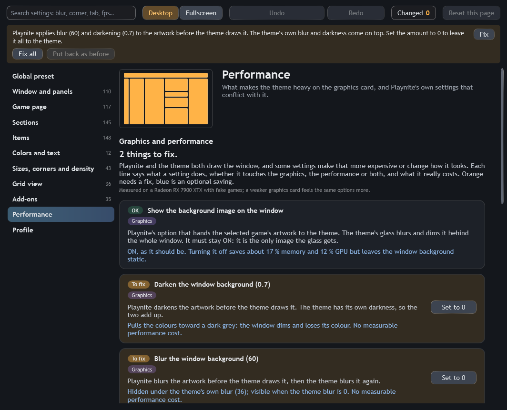
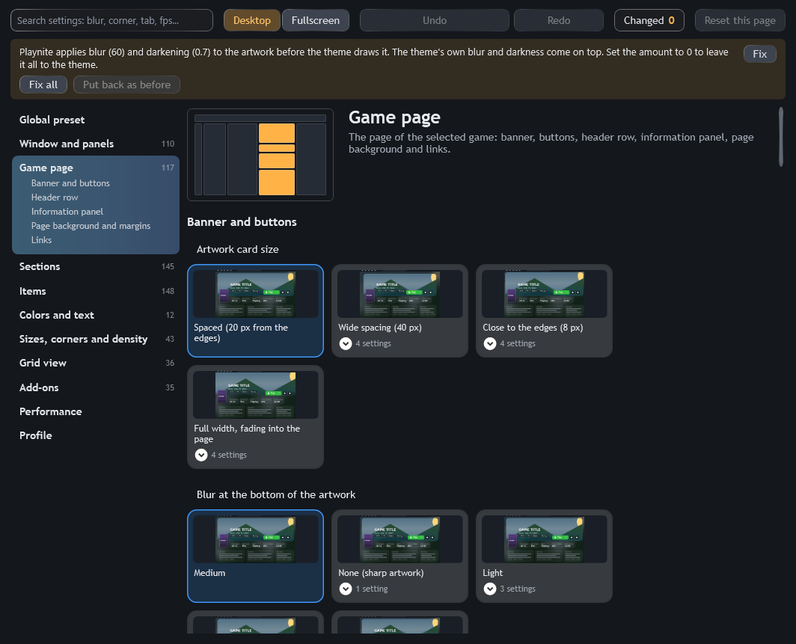
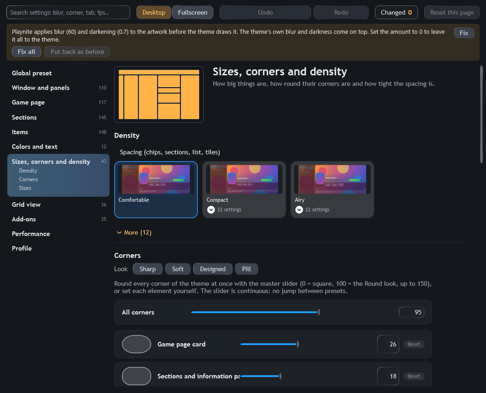
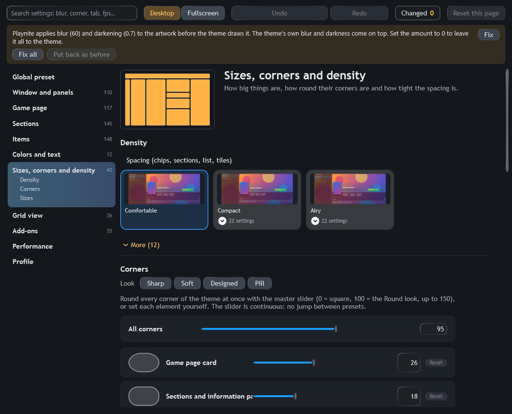
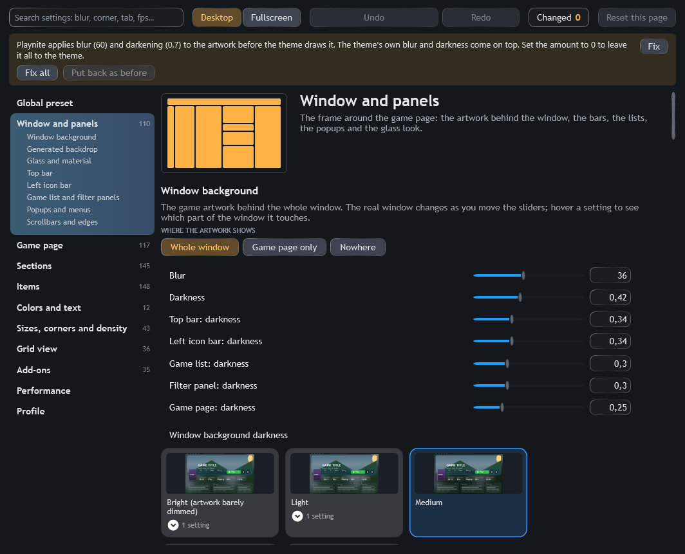

<div align="center">

**🤖 Made with [Claude Code](https://claude.com/claude-code), Anthropic's coding agent**

# Layout Studio

### A live layout editor for Playnite themes. Drag it, size it, colour it, and watch the real window change.

The editor behind the **[Modula](https://github.com/YannD-Delta/Modula)** theme, as a Playnite extension.

It edits **705 settings** (646 for Modula Desktop, 59 for Modula Fullscreen), with 30 ready-made global looks, a generated window backdrop, live undo and redo, and a shared look for both modes. Built end to end with [Claude Code](https://claude.com/claude-code).

[](https://playnite.link)
[](LICENSE)
[](https://claude.com/claude-code)


</div>

---

## What it is

Theme options pages are long lists of dropdowns you change blind, then restart to see. Layout Studio is the opposite: a real editor that lives next to your library and applies every change **instantly** to the running window.

- **Drag sections** between the two columns of the details page, hide them, or choose whether they start collapsed.
- **Resize with handles**: top panel, cover, play button, description width.
- **Pick header cards** by dragging a card type onto a slot, or swap two slots.
- **Tune the glass**: background blur, darkness and panel opacity, with a live preview.
- **Colour profiles, accents and any `#RRGGBB`** of your own.
- **A Graphics and performance page, first in the editor**: it checks Playnite's own window-background options and a few theme choices, says for each one whether it touches the graphics, the performance or both, quotes what it really costs (numbers measured on a test machine, not guesses), and fixes the Playnite ones in one click, with an undo.
- **Presets as picture tiles**, short choices as a segmented bar, number boxes with no hard limit (the slider is a guide, type any value).
- **Gear buttons in the theme** open the editor on the page that holds the setting.
- **Search every setting** (`blur`, `corner`, `fps`...), one page of settings per area, a reset button per page.
- **Undo / redo** (Ctrl+Z / Ctrl+Y); a drag is one step.
- **Profiles you can share**: export as a short text code, paste someone else's code to use it.
- **Safe by design**: a reset or an import keeps a `.bak` copy first, a profile from a newer version opens read-only, and if anything fails the theme falls back to its built-in defaults.
- **Fullscreen too**: a quick menu in the Fullscreen main menu changes accent, corners, glow and information cards with the controller.
- **Colour rules for facts**: FPS, CPU, GPU, RAM and scores get a colour by value, the same rules on desktop and Fullscreen.

<table>
<tr>
<td width="50%"></td>
<td width="50%"></td>
</tr>
<tr>
<td align="center"><sub>Detects a setting that breaks the look or costs performance, and fixes it</sub></td>
<td align="center"><sub>All clear, with the optional savings below</sub></td>
</tr>
</table>

<table>
<tr>
<td width="33%"></td>
<td width="33%"></td>
<td width="33%"></td>
</tr>
<tr>
<td align="center"><sub>Colour profiles and accents</sub></td>
<td align="center"><sub>Looks, spacing, corners</sub></td>
<td align="center"><sub>Header cards</sub></td>
</tr>
<tr>
<td width="33%"></td>
<td width="33%"></td>
<td width="33%"></td>
</tr>
<tr>
<td align="center"><sub>Sizes</sub></td>
<td align="center"><sub>Corners</sub></td>
<td align="center"><sub>Background and glass</sub></td>
</tr>
</table>

## Install

1. Download `LayoutStudio.pext` from the [Releases](https://github.com/YannD-Delta/Layout-Studio/releases) page and double-click it (or drop it on Playnite).
2. Install the [Modula](https://github.com/YannD-Delta/Modula) theme and select it in *Settings > Appearance*.
3. Disable the **Theme Options** extension if you have it: Layout Studio stays idle while Theme Options is enabled so a setting is never applied twice (the reason is written to `extensions.log`).
4. Open **Main menu > Extensions > Layout Studio**.

On first start without a profile, Layout Studio offers to import your existing Theme Options settings (read only: your Theme Options configuration is never modified).

> Layout Studio currently targets Modula (it looks for Modula's theme ids). The editor itself is data driven, see below, so supporting another theme means shipping a schema for it.

## The editor, page by page

| Page | What you do |
| --- | --- |
| Global preset | One card per ready-made look (with a real picture of the window); a click, then a second click, applies the whole look and saves your previous profile first. A new profile starts from the default preset and "Reset all" returns to it |
| Graphics and performance | What Playnite's settings and the theme cost, what to fix, optional savings, and a button to fix each |
| Sections | Drag a details-view section to reorder it or move it to the other column (an amber line shows where it lands), or press its left/right button; the eye hides it, the arrow sets whether it starts open. Every section can change column |
| Items | One foldable card per piece of information or section (Genres, Release date, HowLongToBeat...) with every option for it: show in the chips, new line, section open by default, column, tab, grid view. The **...** button of a section block opens its card |
| Sizes | Drag the handle of a box (top panel, cover, play button...); values are clamped to a sane range. A dock says whether the selected size is on screen now (view and selected game) and draws it when it is not |
| Header cards | Drag a card type onto a slot, or drag a slot onto another to swap |
| Corners | One rounding scale for the card, panels, tiles, chips and buttons, with four one-click looks (Sharp, Soft, Designed, Pill) |
| Background | Blur, darkness and side-panel opacity of the artwork behind the window |
| Colors | A colour profile, an accent, or a custom `#RRGGBB` |
| Thresholds | When the median FPS, CPU, GPU, RAM and score figures turn red, orange, green or blue, and which colours those are |
| Settings pages | Appearance, Background and glass, Top and side bars, Game header, Game page, Grid view, Text and links, Glass and popups, Extensions: every other theme setting, searchable, without repeating what a visual page already edits |
| Profile | Switch between saved profiles or start a new one from the current look, share code export/import and a safe reset |
| Diagnostics | What Layout Studio sees (versions, schema, profile, Playnite settings, sensors), with a copy button for bug reports |

An orange arrow badge marks the few choices that change the *shape* of controls (button style, top panel, neon style): they apply after you restart Playnite, and a banner tells you when one is pending.

## Profiles

Everything you set lives in a small JSON profile under the extension's data folder (`ExtensionsData\<plugin id>\profiles\`), saved automatically a moment after your last change and when the editor closes. Only values that differ from the theme defaults are stored, so a theme update keeps your choices.

Recover from a bad profile:

- Before an import or a reset, the saved profile is copied to `<name>.before-import-<time>.bak` or `<name>.before-reset-<time>.bak`. To go back, close Playnite and rename the copy to `<name>.profile.json`.
- Every real change also keeps the previous file as `<name>.bak` (one step back).
- To start over without the editor, delete the profile file: the theme returns to its defaults.

## How it works

A theme reads each layout constant either as a normal resource or through a binding like `{PluginSettings Plugin=LayoutStudio, Path=Options[Key]}`. Layout Studio overrides the resources and exposes `Options[Key]` with change notification, so every constant follows an edit immediately. The few structural presets (XAML that defines styles) are merged when Playnite starts.

The editor is **schema driven**: a theme ships a `layout-studio.schema.json` that lists its constants, their types, ranges, defaults, presets and which brushes depend on them. Modula's schema is generated from its `options.yaml` by a script in the theme repository.

Facts such as FPS, CPU or scores are exposed to the theme as `{PluginSettings Plugin=LayoutStudio, Path=Facts.X}` with the colour rules already applied.

## What it touches

Playnite extensions run with your user rights, so here is exactly what this one does (you can check it in `layout-studio/src`):

- **No network access**, no process started, no native code.
- **Writes** only inside its own data folder (`ExtensionsData\<plugin id>`): your profiles, their `.bak` copies, and small flag files.
- **Changes Playnite's own settings** (the window background options) only when you press **Fix** in the editor banner, and keeps the previous values so **Put back as before** restores them.
- **Reads, never writes**: the GameActivity data of the selected game (for the FPS, CPU, GPU and RAM figures), Theme Options' saved settings (once, only to offer an import), and the HWiNFO sensor registration of the current Windows user (to warn when the gadget and GameActivity disagree).
- **Clipboard**: used only when you press Export on the Profile page.
- Testbed helpers (a sample library and an "open the editor" marker) only act when special flag files exist in Playnite's configuration folder; they are not present on a normal install.

Playnite's add-on database is not accepting new extensions at the moment (the maintainer plans a new submission and verification system with Playnite 11), so install the `.pext` from the [Releases](https://github.com/YannD-Delta/Layout-Studio/releases) page.

## Build and test

Requirements: Windows, Playnite 10.x installed (for `Playnite.SDK.dll`), the .NET Framework 4 compiler. A Roslyn toolset under `tools/roslyn` (the `Microsoft.Net.Compilers.Toolset` NuGet package) is used when present, otherwise the legacy C# 5 compiler.

```powershell
pwsh tools\build.ps1 -Target plugin     # build\LayoutStudio\LayoutStudio.dll + extension.yaml
pwsh tests\run.ps1                      # builds and runs the test harness
```

Set `PLAYNITE_DIR` if Playnite is not in `%LOCALAPPDATA%\Playnite`. To make an installable package, zip the content of `build\LayoutStudio` (the `.dll` and `extension.yaml`) and rename it `LayoutStudio.pext`.

The tests are a small self-made harness (no test framework): the core logic (profiles, history, schema validation, rules, quick menu...) is pure C# and runs without Playnite.

## Made with Claude Code

Layout Studio was designed and written together with [**Claude Code**](https://claude.com/claude-code), Anthropic's coding agent: the C# extension, the WPF editor, the tests and the docs. The product direction and every decision are human; the agent wrote the code, ran the tests and took the screenshots from a sandbox Playnite filled with fictional games.

## Feedback

- Open an [issue](https://github.com/YannD-Delta/Layout-Studio/issues) on GitHub for bugs and ideas.
- Talk to me on Discord: **yannd_delta** (or open an issue, either is welcome).
## Licence

[MIT](LICENSE).
